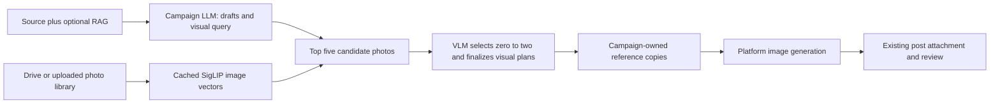

# Automatic campaign photo retrieval

Implemented locally, 24 October 2026. Caption-retrieval and latency experiments
remain separate: [IMAGE_RETRIEVAL_EVALUATION.md](IMAGE_RETRIEVAL_EVALUATION.md).
The automated selector and query rewriter have integration tests; their campaign
relevance accuracy has not yet been evaluated with human labels.

## Current workflow

1. Manually sync Drive using the existing MCP client, or upload photos into the
   dashboard Photo library. The existing Drive cache supplies 20 photos for owner 1.
   Benchmark images are not imported into the user's campaign library.
2. Click **Index new or changed photos**. SigLIP 2 creates image embeddings locally.
   Identical content/model/preparation versions are reused. Missing or changed Drive
   assets are excluded from new searches. RAG document processing is independent.
3. In the composer, enable **Generate campaign images**, then **Automatically find
   photos from my library**. This mode is mutually exclusive with manual product
   attachments. Choose whether no suitable photo stops the image attempt (default)
   or permits a generic topic illustration.
4. The existing campaign LLM returns drafts, provisional platform visual plans,
   and one short `image_search_query`. Its rewrite preserves explicit visual
   requirements and omits marketing instructions. It has not seen the library yet.
5. SigLIP 2 searches the current owner's ready image embeddings and returns up to
   five candidates. The 64-token query budget is validated; oversized queries fail
   explicitly rather than silently losing constraints. Scores rank candidates and
   are not calibrated relevance probabilities. No arbitrary score cutoff is used.
6. One additional vision call sees the actual five photos and original campaign
   context, selects zero to two unique known IDs, explains selections/no-match,
   and finalizes all requested platform visual plans. It can reject every candidate.
   Selection is shared across platforms, so it is one selection call per campaign.
7. Selected photo bytes are hash-checked and copied into campaign-owned immutable
   reference records. The worker passes only those actual prepared photos and the
   platform-specific prompt to image generation. Embeddings/scores are not sent as
   image-generation references. There is no manual photo-confirmation step.
8. The existing system attaches the generated visual to its platform post. Final
   draft/image review and publishing approval continue through the existing flow.



## Reference roles and no-match handling

General library photos are scene/composition references. Their exact advertised
product, venue, or event identities are unverified. The selector must reject an
unverified lookalike when exact identity is essential. For an exact product photo,
use the existing manual attachment mode. Future catalog identity metadata could
support automatic product-specific matching, but is not implemented here.

Migration `0015_image_reference_roles` adds `CampaignImage.reference_role`, with
existing/manual attachments defaulting to `product` and automatically imported
library assets marked `scene`. The role survives manual regeneration. Scene-aware
prompts use general subject guidance instead of assuming every photo is a product.

No-match plus `stop` preserves generated drafts and a failed visual attempt with
an explanation; the paid image-generation call is skipped. `illustration` explicitly
allows generation with no photo references. A malformed selector response, unknown
ID, duplicate ID, or invalid plan fails validation; it is not treated as approval.

The initial visual plan is provisional. The selector actually sees the retrieved
photos and finalizes the plan in the same extra call. There is no separate second
visual-planning call for successful automatic jobs.

## Storage and access

- `rag.image_library`: owner/source IDs, immutable SHA256, local path, source metadata,
  embedding status, encoder/revision/preparation version, and `VECTOR(768)`.
- `rag.image_library_jobs`: per-owner local indexing progress and failures.
- BGE's text embeddings remain in separate existing tables; they are not compared
  with SigLIP image queries or put into the new 768-dimensional image column.
- Uploaded library bytes: `data/image_library/{owner}/` (Git-ignored).
- Synced originals: the existing `data/drive_sync/images/` cache.
- Selected campaign copies: existing private campaign image storage.
- `CampaignVisual.context.image_retrieval`: query, model/revision, candidate IDs,
  scores/hashes, selected IDs/reasons, campaign-copy IDs, selector usage, and policy.
- All library APIs and vector searches filter by authenticated owner. Files are
  authenticated, decoded/sanitized before preview, and hash-checked before use.
- A cached model is shared within an API process with serialized encoder access.
  Multiple server processes have separate model copies; size memory accordingly.

## API and code

| Endpoint | Purpose |
|---|---|
| `GET /image-library` | Discover cached Drive assets; return library/indexing status |
| `POST /image-library/images` | Upload a reusable scene reference, at most 10 MB |
| `POST /image-library/index` | Queue local incremental embedding work |
| `GET /image-library/images/{id}/file` | Authenticated sanitized preview |
| `POST /image-library/search` | Optional direct short-query search/diagnostics |
| `POST /posts/{id}/variants` | Existing generation endpoint now accepts `auto_select_images` and `image_no_match_policy` |

Reusable encoder/store: `integrations/image_retrieval/`. Selector and planning:
`app/services/image_selection.py`. Existing campaign visual worker handles generation
and attachment. The Photo library panel and selection audit live in the React dashboard.

Indexing and visual jobs use this local API process's background tasks. They are not
an external durable worker queue. Interrupted indexing can be retried after its
stale-job timeout; paid visual requests retain the existing explicit retry behavior.
Drive synchronization is still a separate manual MCP command; campaign requests do
not scan all Drive files or download every photo again.

## Costs, runtime, and local setup

Photo indexing and retrieval are local. Automatic campaign generation adds one
vision selection/planning call, plus the existing image-generation call per platform.
Rewriting is included in the initial campaign call and adds output tokens. Selection
usage is retained in the visual audit and included in generation-run usage when
reported. Missing provider cost remains unknown. A warm vector search latency does
not include the campaign LLM, selector, image generator, network, or cold model load.

The current Mac API uses `/Users/omar/.codex/social-studio-app-venv/bin/python`.
This optional environment reuses local ML packages and installs the project's
FastAPI 0.116.1 / Starlette 0.47.3 pair locally. It avoids modifying the separate
MCP environment, whose newer Starlette installation is incompatible with this
project's pinned FastAPI. Both services can coexist in their own environments.

```bash
/Users/omar/.codex/social-studio-app-venv/bin/python -m scripts.run_local migrate
/Users/omar/.codex/social-studio-app-venv/bin/python -m scripts.run_local api
```

The 20 Drive photos were indexed successfully. Model weights are reused from the
pinned local cache; moving machines requires model installation and a fresh Drive
cache/index. Dataset files, weights, `.env`, and private library bytes stay out of Git.

## Validation completed

- Actual local SigLIP encoding and pgvector retrieval on the 20 cached Drive photos.
- Cross-owner file access checked against PostgreSQL: 404.
- 29 targeted API/media tests: selected pixels only, one selector call, no-match stop,
  explicit illustration fallback, unknown ID rejection, source hash changes, empty
  library preflight, manual/automatic mode exclusion, structured query parsing,
  and scene-role retention through regeneration; existing image/RAG tests also pass.
- Frontend production build and Python compilation/whitespace checks pass.
- Paid selector/image-provider responses were mocked in integration tests. This
  integration work did not consume OpenRouter credits or publish any content.
- Browser sign-in was unavailable with its saved credentials; authenticated visual
  review of the new controls still needs a user sign-in. API behavior and frontend
  compilation were verified independently.

## Query rewriting and selector evaluation still needed

Keep a separate 200-image gallery from the 3,400 outside the caption pilot, checking
for duplicates. Write 30 realistic campaign briefs before viewing rankings: 10 for
prompt development and 20 held out, with related topics kept together. Include
broad, constrained, ambiguous, exact-product, and no-match requests.

Compare raw brief versus rewritten query with the same SigLIP model/gallery/top five.
Record raw-query truncation. The rewriter must not receive gallery captions or gold
image IDs. Blindly judge the union of both top-five lists: 0 unsuitable, 1 partly
suitable, 2 clearly suitable. Report judged Precision@5, strong-match rate, Success@5,
constraint retention/invention, and extra latency/cost. Unjudged photos are not
confirmed negatives; report known-source recall separately where a positive exists.

Then evaluate the VLM selector on the labelled candidates: selected-image precision,
useful-reference coverage, wrong exact-identity acceptance, correct empty selection
on no-match briefs, and rejection of useful photos. Schema-valid output is not
proof of relevance. Freeze prompts before held-out comparisons and report losses
as well as gains. No automatic score threshold or campaign accuracy claim has yet
been justified by these experiments.

## Dashboard navigation

The workspace now uses a left sidebar with separate Add documents, Add images,
Generate campaign, Review campaigns, Activity, Overview, and Connected accounts
sections. The sidebar becomes a horizontal navigation strip on smaller screens.
Sections stay mounted when hidden, preserving campaign inputs and background
processing when switching views. A successful campaign opens its review section.

Completed document ingestion cards disappear and trigger a success toast only
after indexing succeeds. Processing and failed uploads remain visible while needed.
Stored documents are available through the collapsed Browse document library
control, matching the photo library browsing pattern. They are not deleted.

## Workspace-reference correction — 25 October 2026

A live campaign failure exposed requirement drift: the source requested general
home-workspace inspiration, but the generated query/visual plan added natural
light, which the selector then treated as mandatory. The original source and
empty design-preferences field did not impose that condition. Manual inspection
of candidates 6, 10, 18, 19, and 20 confirmed computer-workstation content; images
10 and 20 are useful composition references. The photos do not establish whether
they were taken in residential homes.

Selector prompt `library-select-plan-v4` receives original campaign requirements
separately from generated copy. It no longer receives the provisional visual plan
or rewritten query as acceptance criteria. Rewriting instructions also prohibit
adding scene attributes solely for aesthetics. Only explicit original requirements
can establish hard visual constraints; relevance must still be evaluated on real briefs.

Each selected photo now includes optional `adaptation_notes` (for example brighten
lighting, reduce clutter, simplify the background, or reframe). The image worker
forwards these notes with the corresponding reference position to image generation,
and the dashboard displays them beside selection reasons. Explicit user design
requirements take precedence. Unrelated subjects or unverified exact product
identities must still be rejected; adaptation is not permission to override them.

Null no-match explanations are valid only for nonempty selections and are normalized
for storage. Empty selections still require a real explanation. Optional adaptation
notes may also be null. Existing image attempts retain their original audit; new
attempts use the updated prompt/schema.

Validation: 35 targeted tests and frontend build pass. Tests cover the note handoff,
separation of generated details from source requirements, preservation of explicit
user requirements, and null-field handling. No paid provider calls were made for
these corrections. Prompt effectiveness on the live selector still needs checking
on a new campaign attempt; schema/integration tests do not prove model accuracy.
